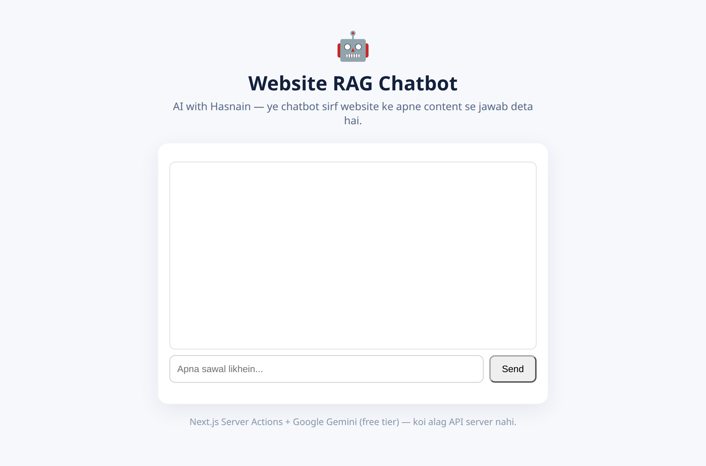
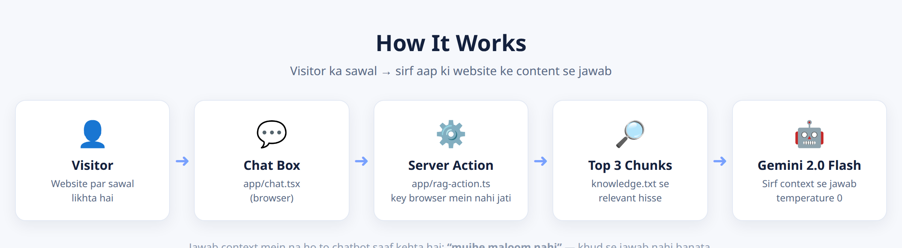
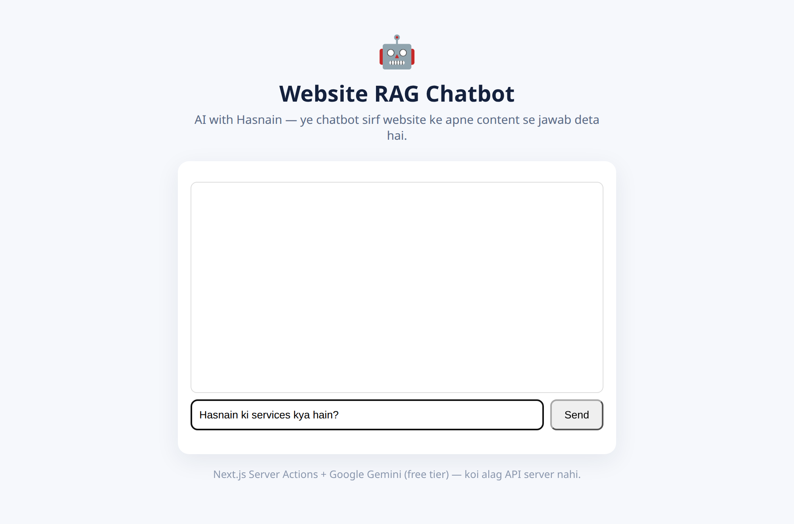

# Website RAG Chatbot (FREE) — Next.js + Gemini

An AI chatbot for your own website that answers visitors' questions **only from your website's own content** — and honestly says "mujhe maloom nahi" (I don't know) when the answer is not in your data.

Built with **Next.js Server Actions** + **Google Gemini free tier**. No separate API server, no OpenAI key, no bill to start.

📺 From the **AI with Hasnain** YouTube tutorial: *Build Your Own AI Chatbot for Any Website — RAG Tutorial (FREE)*

<p align="center">
  
</p>

## How it works

<p align="center">
  
</p>

1. Your website's text lives in `data/knowledge.txt`.
2. `app/rag-action.ts` (a Server Action) splits it into chunks (1000 / 200 overlap), embeds them with `text-embedding-004`, and keeps them in an in-memory vector store.
3. For each question it retrieves the top 3 relevant chunks and asks `gemini-2.0-flash` (temperature 0) to answer **only** from that context.
4. `app/chat.tsx` is the chat box — it calls the Server Action directly, so the API key never reaches the browser.

## Screenshots

<p align="center">
  
  
</p>
<p align="center"><i>The chat box, and a visitor asking a question. The bot answers only from <code>data/knowledge.txt</code>.</i></p>

## Setup
1. Get a free API key from [Google AI Studio](https://aistudio.google.com) — no credit card needed.
2. Copy `.env.example` to `.env.local` and put your key in it. **Never commit `.env.local`.**
3. Install and run:
   ```bash
   npm install
   npm run dev
   ```
4. Put your real website content in `data/knowledge.txt` — one heading per page/section. When your website changes, update this file too, or the chatbot will give old answers.

## Honest limits
- Gemini free tier is roughly 15 requests/minute and 1,500 requests/day (Google can change these limits — check AI Studio pricing). If the limit is hit, visitors see a clear "try again later" message instead of a crash.
- No RAG system can guarantee 100% accuracy. Answers come only from `data/knowledge.txt`.
- For heavy traffic, swap `MemoryVectorStore` for Supabase pgvector (free tier) later — the rest of the code stays the same.

## Files
- `app/rag-action.ts` — the RAG Server Action (the core of the tutorial)
- `app/chat.tsx` — the chat box component
- `data/knowledge.txt` — your website's content (the chatbot's only source)
- `screenshots/` — the chat interface and the how-it-works diagram
